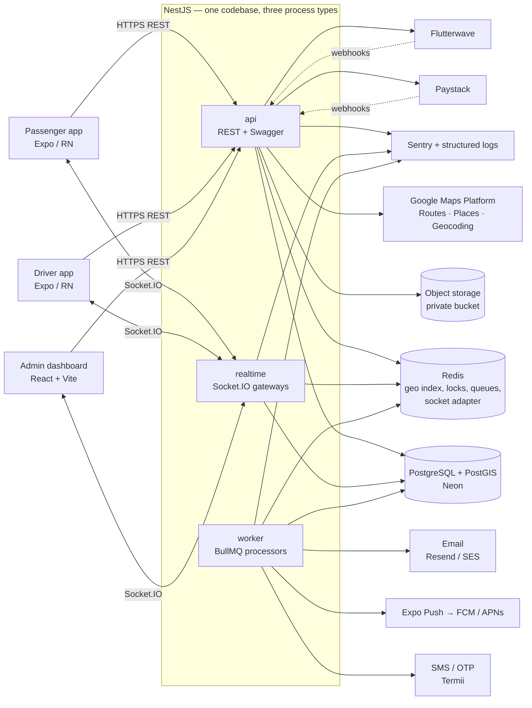
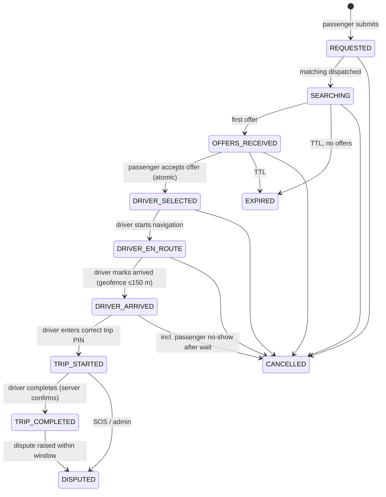

# Software Architecture — Phase 1

Status: **Draft for review** · Scope: passenger app, driver app, admin dashboard, API, real-time, payments · Launch city: Abuja

Companion documents: [DECISIONS.md](./DECISIONS.md) (why), [API_CONTRACTS.md](./API_CONTRACTS.md) (REST + WebSocket), [STANDARDS.md](./STANDARDS.md) (how we write code), [`schema.prisma`](../packages/database/prisma/schema.prisma) (data), [`001_integrity.sql`](../packages/database/prisma/sql/001_integrity.sql) (DB-level guarantees).

---

## 1. System context



**One backend, one database.** All three clients talk to the same NestJS deployment. The backend is the single source of truth for ride state, money and permissions; clients render what the server says.

**Three process types from one codebase.** `api`, `realtime` and `worker` are separate entrypoints of the same NestJS app (`apps/api/src/main.api.ts`, `main.realtime.ts`, `main.worker.ts`). They scale independently: realtime scales with connected drivers, worker with queue depth, api with request rate. Locally they can run in one process.

## 2. Repository structure (pnpm + Turborepo monorepo)

```
zuma/
├─ apps/
│  ├─ api/                     NestJS (api, realtime, worker entrypoints)
│  │  └─ src/
│  │     ├─ main.api.ts | main.realtime.ts | main.worker.ts
│  │     ├─ common/            guards, interceptors, filters, idempotency, pagination, money
│  │     ├─ config/            typed env (zod), feature flags
│  │     ├─ infra/             prisma, redis, queues, storage, maps, sms, push, mail clients
│  │     └─ modules/           one folder per bounded module (list in §4)
│  ├─ passenger/               Expo Router app
│  ├─ driver/                  Expo Router app
│  └─ admin/                   React + Vite + Tailwind + shadcn/ui
├─ packages/
│  ├─ database/                Prisma schema, migrations, integrity SQL, seed
│  ├─ contracts/               Zod schemas + TS types shared by API and all clients
│  │                           (REST DTOs, socket event payloads, enums, error codes)
│  ├─ mobile-core/             shared RN code: API client, socket client, auth store,
│  │                           offline queue, location service, map components
│  ├─ ui-tokens/               design tokens (colour, type, spacing) consumed by RN + Tailwind
│  ├─ i18n/                    en (launch), ha / yo / ig / fr catalogues
│  └─ config/                  eslint, tsconfig, prettier presets
├─ docs/
├─ .github/workflows/          ci.yml, deploy-api.yml, deploy-admin.yml, eas-build.yml
├─ turbo.json  pnpm-workspace.yaml  package.json
```

`packages/contracts` is the anti-drift mechanism: the API validates with the same Zod schemas the apps use to type their requests, and NestJS DTOs are generated from them (`nestjs-zod`), so Swagger, server validation and client types cannot disagree.

## 3. Ride lifecycle

### 3.1 State machine



`REQUESTED → OFFERS_RECEIVED` lives on **RideRequest**; from `DRIVER_SELECTED` onward state lives on **Ride** (created at acceptance). The full transition table — who may trigger each edge and what side-effects run — is implemented as a single pure function `transition(ride, event, actor) → { next, effects } | Error` in `modules/rides/state-machine.ts`, unit-tested exhaustively. Every transition: (1) checks actor authorization, (2) updates with `WHERE id = ? AND version = ?` (optimistic lock), (3) inserts `RideStatusHistory`, (4) enqueues side-effects through an outbox so sockets/push fire only after commit.

### 3.2 Negotiation and atomic acceptance

```mermaid
sequenceDiagram
  autonumber
  participant P as Passenger
  participant API
  participant M as Matching (worker)
  participant R as Redis
  participant DB as Postgres
  participant D as Drivers

  P->>API: POST /ride-requests {pickup, dropoff, category, proposedFare, Idempotency-Key}
  API->>API: Routes API → road distance/duration
  API->>DB: load active PricingConfiguration; validate minFare ≤ fare ≤ maxFare, ≥ km × minFarePerKm
  API->>DB: insert RideRequest(REQUESTED) + FareNegotiation(PASSENGER_PROPOSED)
  API-->>P: 201 {requestId, expiresAt}
  API->>M: enqueue match(requestId)
  M->>R: GEOSEARCH drivers:{area}:{category} radius r
  M->>M: filter online, verified, not suspended, no active ride; rank
  M->>DB: insert RideDispatch rows; status → SEARCHING
  M-->>D: ws ride_request.new (masked passenger, fare, timer)
  D->>API: POST /ride-requests/:id/offers {amount | acceptPassengerPrice}
  API->>DB: upsert RideOffer (one per driver), FareNegotiation event
  API-->>P: ws offer.upserted
  P->>API: POST /ride-requests/:id/offers/:offerId/accept
  API->>DB: BEGIN; SELECT … FOR UPDATE RideRequest, RideOffer
  API->>DB: check request open, offer PENDING & unexpired, driver still free
  API->>DB: insert Ride(agreedFare = offer.amount)  ← unique(rideRequestId), unique(acceptedOfferId), partial unique(driverId active)
  API->>DB: offer → ACCEPTED, others → REJECTED; request → DRIVER_SELECTED; COMMIT
  API-->>D: ws ride.assigned (winner) / offer.closed (others)
  API-->>P: 200 {ride, driver, vehicle, tripPin}
```

Race safety is layered: row locks serialize concurrent accepts on one request; the unique constraints make a second `Ride` for the same request or offer impossible even if application logic were wrong; the partial unique index on `Ride(driverId) WHERE active` stops one driver being assigned two rides by two passengers at the same moment. If the insert fails on that index the passenger gets `409 DRIVER_NO_LONGER_AVAILABLE` and the offer is marked `WITHDRAWN`.

Radius expansion: if no offers within `searchRadiusM` after N seconds, the worker re-runs matching at `r + radiusStepM` up to `maxSearchRadiusM`, excluding already-dispatched drivers. The passenger can also raise the fare (`PASSENGER_RAISED_FARE`), which re-broadcasts.

### 3.3 Matching

Hot state is in Redis, durable state in Postgres:

| Redis key | Content | TTL |
|---|---|---|
| `drv:geo:{areaId}:{categoryKey}` | GEO set of online, free drivers | — (members removed on offline/assign) |
| `drv:hb:{driverId}` | last heartbeat ts, lat/lng, heading | 45 s → expiry = auto offline |
| `drv:busy:{driverId}` | rideId | while on ride |
| `req:{requestId}:dispatched` | set of driverIds already sent | request TTL |
| `lock:accept:{requestId}` | short Redlock to shed duplicate taps before hitting DB | 5 s |

Ranking score (configurable weights in `PlatformSetting`): `w1·(1 − dist/r) + w2·rating/5 + w3·acceptanceRate − w4·cancellationRate`. Pickup ETA for the top K candidates is refined with the Routes Matrix API before display so drivers and passengers see road ETAs, not straight-line guesses. Straight-line distance is only used as a pre-filter.

A keyspace-expiry listener on `drv:hb:*` marks drivers offline when heartbeats stop (app killed, phone off, network dead).

## 4. Backend modules

Modules follow the list in the brief. Dependencies point inward to `LedgerModule`, `AuditModule` and `infra`; no module reaches into another's tables — it calls that module's service.

| Group | Modules | Owns |
|---|---|---|
| Identity | Auth, Users, Passengers, Admin | User, sessions, OTP, devices, RBAC, admin 2FA |
| Supply | Drivers, DriverVerification, Vehicles | Driver, documents, vehicles, verification history |
| Geo | Locations, Maps, Cities, Pricing | saved places, provider adapters, cities, areas, pricing versions |
| Trip | Rides, RideMatching, FareNegotiation, TripTracking | requests, offers, rides, state machine, breadcrumbs |
| Money | Payments, Wallet, Ledger, Commission, Withdrawals | payments, webhooks, wallets, journal, commissions, payouts, settlements |
| Engagement | Notifications, Messaging, Ratings, Promotions, Referrals | |
| Trust | Support, Disputes, Safety, Audit | tickets, disputes, incidents, audit trails |
| Ops | Reports, Files | read models / exports, signed-URL storage |

Cross-cutting (in `common/`): `JwtAuthGuard`, `PermissionsGuard` (`@RequirePermission('drivers:approve')`), `IdempotencyInterceptor`, `AuditInterceptor` for admin writes, global `ZodValidationPipe`, `AllExceptionsFilter` → uniform error envelope, `@nestjs/throttler` with Redis store, request-id + pino logging, URI versioning `/v1`.

**Transactional outbox.** Side-effects (socket emits, push, SMS, webhooks to nobody else) are written to an `outbox` queue inside the DB transaction via BullMQ `FlowProducer` triggered after commit. Nothing is emitted for a transaction that rolled back.

## 5. Real-time

Socket.IO on the `realtime` process, `@socket.io/redis-adapter` for fan-out across instances, sticky sessions at the load balancer.

- **Auth:** access JWT in the handshake `auth` payload; re-validated on reconnect; connection dropped when the token expires (client refreshes over REST and reconnects).
- **Rooms:** `user:{userId}`, `driver:{driverId}`, `ride:{rideId}` (passenger + driver + admins viewing), `area:{areaId}:drivers` (broadcast fallback), `admin:ops:{cityId}`.
- **Client → server events** are validated with the shared Zod schemas and are limited to high-frequency, low-stakes inputs: `driver.location`, `driver.heartbeat`, `chat.typing`, `ack`. **Anything that changes ride state or money is a REST call**, so it gets idempotency keys, HTTP status codes and audit logging. Sockets push the outcome.
- **Delivery guarantees:** every server event carries `{eventId, seq, rideId?, sentAt}`. Clients keep the last `seq` per room and call `GET /v1/rides/:id/sync?afterSeq=` after reconnect to fill gaps. Clients drop duplicate `eventId`s.
- **Location throttling:** driver app sends every 4 s or 25 m (whichever first) on trip, every 10 s while idle online; server drops updates closer than 2 s apart, writes Redis GEO immediately, batches Postgres writes (`RideLocation` every ~5 s, `DriverLocation` every ~30 s). Passenger receives driver position only for their own active ride.

## 6. Money

### 6.1 Principles
- Amounts are integer **kobo** (`BigInt`), never floats. Formatting to ₦ happens only in the UI.
- **Double-entry ledger**: every movement is a `LedgerTransaction` with ≥2 `LedgerEntry` rows whose debits equal credits — enforced by a deferred DB trigger, not just code.
- **Wallet balances are caches** of ledger account sums, updated in the same transaction as the entries, with optimistic locking. A nightly job recomputes balances from entries and alerts on any mismatch.
- **Immutable**: ledger rows cannot be updated or deleted (trigger + DB grants). Corrections are reversal transactions.
- **Payment truth comes from the provider**, via signature-verified webhook *or* server-side verify call, never from the app.
- **Idempotency** on every money-moving operation: client `Idempotency-Key` header on REST, `LedgerTransaction.idempotencyKey` derived deterministically (e.g. `commission:{rideId}`) so retries and duplicate webhooks are no-ops.

### 6.2 Postings (DR = debit, CR = credit)

| Event | Entries |
|---|---|
| Wallet top-up via Paystack confirmed | DR `PAYSTACK_CLEARING` · CR passenger `WALLET_AVAILABLE` |
| Ride paid from wallet (fare F, commission C) | DR passenger `WALLET_AVAILABLE` F · CR driver `WALLET_PENDING` F−C · CR `PLATFORM_COMMISSION_REVENUE` C |
| Ride paid by card | DR `PAYSTACK_CLEARING` F · CR driver `WALLET_PENDING` F−C · CR `PLATFORM_COMMISSION_REVENUE` C |
| Ride paid in **cash** | Cash goes driver-hand to passenger-hand; platform only books what the driver owes: DR driver `WALLET_AVAILABLE` C · CR `PLATFORM_COMMISSION_REVENUE` C (driver balance can go negative up to `negativeLimit`; beyond it they can't go online until settled) |
| Promo discount D on electronic ride | DR `PROMO_EXPENSE` D added to the driver credit so the driver is paid on the agreed fare, not the discounted one |
| Pending → available (after dispute window, e.g. 24 h) | DR driver `WALLET_PENDING` · CR driver `WALLET_AVAILABLE` |
| Withdrawal requested | DR `WALLET_AVAILABLE` · CR `WALLET_HELD` |
| Withdrawal paid (transfer webhook success) | DR `WALLET_HELD` · CR `BANK_PAYOUT_CLEARING` |
| Withdrawal failed/rejected | DR `WALLET_HELD` · CR `WALLET_AVAILABLE` |
| Refund to wallet | reversal of the original fare postings (pro-rata for partial) |

**No double commission:** `Commission` has a unique `rideId`; the commission ledger transaction's idempotency key is `commission:{rideId}`; cash and electronic rides take different, mutually exclusive posting paths chosen from `Ride.paymentMethod`, which is locked at acceptance.

### 6.3 Webhook pipeline
`POST /v1/webhooks/{paystack|flutterwave}` → verify signature (Paystack HMAC-SHA512 of raw body with secret key; Flutterwave `verif-hash`) → insert `PaymentWebhook` (unique on provider event id → duplicates return 200 immediately) → respond 200 → worker processes: re-verify with provider API, match `Payment.reference`, check amount & currency, post ledger, mark `PROCESSED`. Unmatched events land in `UNMATCHED` for the reconciliation screen. A scheduled job re-verifies payments stuck in `PENDING` (delayed confirmations).

## 7. Security

| Area | Control |
|---|---|
| Passwords | argon2id (m=19 MiB, t=2, p=1); OTP-first login for passengers/drivers, password optional |
| Tokens | 15-min access JWT (EdDSA); 30-day refresh tokens, opaque, stored hashed, rotated on every use; reuse of a rotated token revokes the whole family (`UserSession.familyId`) |
| Mobile storage | tokens in `expo-secure-store` (Keychain / Keystore) only |
| Admin | password + TOTP mandatory; optional IP allowlist; 12-h session cap; every write audit-logged |
| RBAC | permission keys (`resource:action`) on roles; roles optionally city-scoped (Abuja ops sees Abuja) |
| OTP | 6 digits, hashed, 5-min expiry, 5 attempts, rate limits per phone + IP + device |
| Files | private bucket; uploads via short-lived presigned PUT with content-type/size limits; server verifies magic bytes; malware scan job; reads via 5-min signed URLs after permission check — no public document URLs |
| PII exposure | before acceptance drivers see passenger first name, rating, pickup area only; phone numbers are never shared — calls go through masked numbers (provider TBD) or in-app chat |
| Transport | HTTPS only, HSTS; webhook endpoints verify signatures and are excluded from CSRF; admin uses bearer tokens in memory + httpOnly refresh cookie (SameSite=Strict) |
| Secrets | provider secret stores (Railway/Fly/Render env + Vercel env); never in client bundles; mobile apps hold only public keys (Maps restricted key, Paystack public key) |
| NDPA 2023 | lawful-basis register, consent records (`termsAcceptedAt`, `privacyConsentAt`, `marketingConsent`), DPIA for location processing, data-subject export/delete flows, breach procedure, data-processing agreements with providers |

**Retention (proposal, needs legal sign-off):** raw GPS breadcrumbs 12 months then aggregated; chat 6 months after trip; KYC documents life of driver account + 2 years; financial records 6 years (tax). Account deletion scrubs PII from `User` (name → "Deleted user", phone → hash) but keeps rides, payments and ledger rows.

## 8. Safety / SOS

SOS creates a `SafetyIncident`, notifies the user's emergency contacts by SMS with a live-trip link, and alerts the ops room in real time with location. The app then shows the national emergency number(s) configured per city for the user to call themselves. **The system never states that police or emergency services have been contacted.** `externalEscalatedAt` is set only when an operator records that they actually reached an external service, and only then can the app say so.

## 9. Mobile architecture

- Expo dev builds (not Expo Go) because of background location, maps and push.
- `expo-location` + `expo-task-manager` for background location in the driver app (foreground service notification on Android; "Always" permission flow with explanation screen on iOS). Passenger app requests foreground location only.
- `react-native-maps` with Google provider on both platforms; turn-by-turn handed off to Google Maps / Waze deep links in v1 (embedded nav SDK is a later cost/benefit call).
- Server state in TanStack Query; ephemeral UI and session in Zustand; socket events write into the Query cache so screens have one data source.
- Offline: mutations go through a persisted queue (MMKV) keyed by idempotency key; replay on reconnect; location points buffered with `clientSeq` and flushed in batches; trip-ending actions show "Waiting for confirmation" until the server responds.

## 10. Environments & infrastructure

| | Dev | Staging | Production |
|---|---|---|---|
| DB | Neon branch per PR | Neon `staging` branch | Neon `main` (PITR on), PostGIS |
| Redis | local Docker | Upstash / Redis Cloud | Redis Cloud (non-serverless, needed for keyspace events + BullMQ) |
| API/realtime/worker | local | Railway or Fly.io | same, ≥2 instances each for api/realtime |
| Admin | Vite dev | Vercel preview | Vercel prod, custom domain |
| Mobile | dev client | EAS internal distribution | EAS → Play / App Store |
| Payments | Paystack/Flutterwave **test** keys | test keys | live keys |

CI (GitHub Actions): lint → typecheck → unit tests → integration tests against Postgres+PostGIS and Redis service containers → build. Deploy jobs gated on `main` + manual approval for production; `prisma migrate deploy` runs as a release step before new instances take traffic.

## 11. What Phase 2 starts with

1. Scaffold monorepo exactly as §2; wire `packages/contracts`.
2. Create initial migration from `schema.prisma`, append `001_integrity.sql`, apply to a Neon dev branch, write a seed (roles/permissions, Abuja + service areas, vehicle categories, pricing v1).
3. Auth (OTP, sessions, rotation), Users, RBAC guards, Admin 2FA, Audit interceptor — with integration tests.
